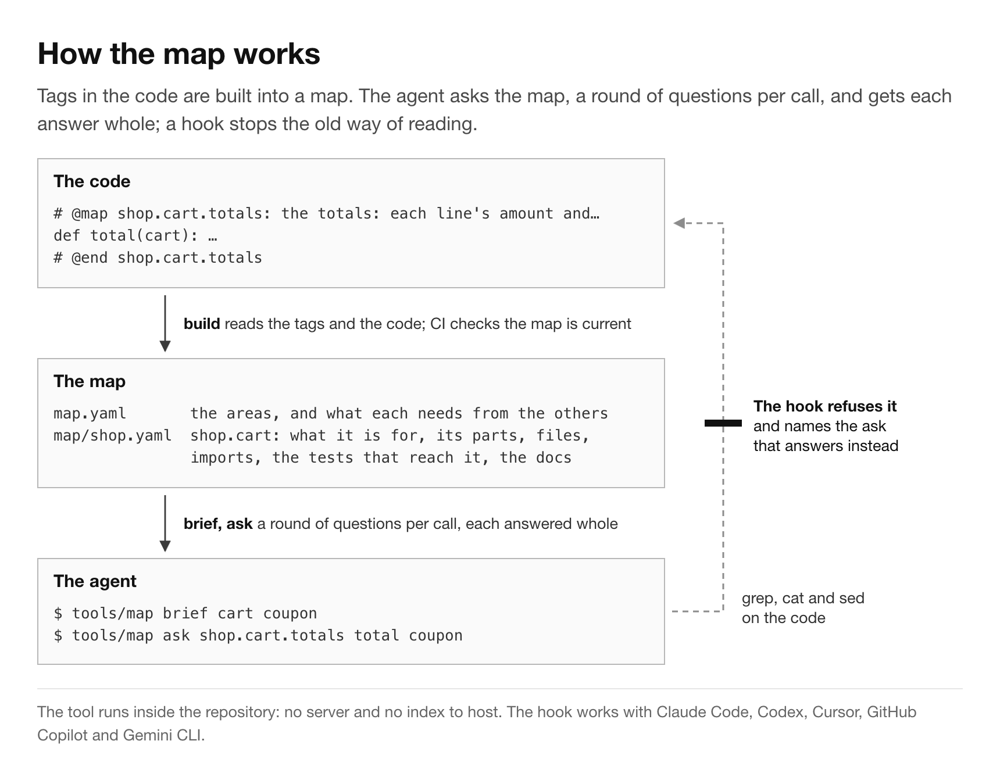
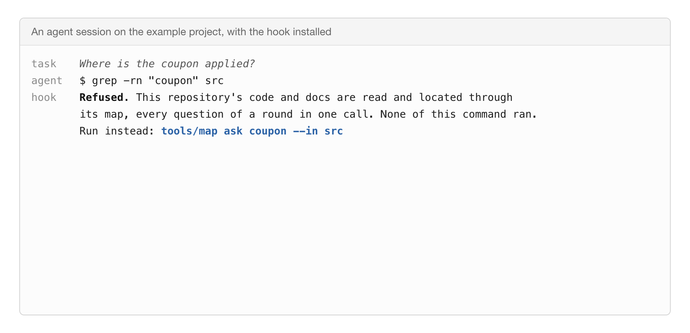
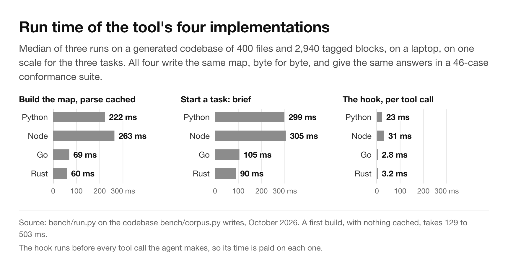

# grepless

[](https://github.com/mars1571/grepless/actions/workflows/check.yml)

**A code map and a pre-tool hook for AI coding agents.** Every block of code carries a one-line tag that says what
it is for. A small tool builds a map from the tags and the code. The agent asks the map, a whole round of questions
per call, instead of searching with `grep` and printing files. A hook refuses `grep`, `cat` and `sed` on the code
and names the question to ask instead.

It works with **Claude Code, OpenAI Codex, Cursor, GitHub Copilot and Gemini CLI**, on any language that has
comments, with no server and no index to host. The command is `tools/map`.



## Why

A coding agent sends its whole conversation to the model on every call. Measured over 113 Claude Code sessions
(26,007 calls, 10.7 billion tokens):

- **98.7% of the tokens were context the model had already been sent.** The agents' own output was 0.3%.
- **The model replied three times slower** with 700k to 900k tokens of context than with under 100k. Among short
  replies alone, it was still about 1.8 times slower.
- **Half of what 23 agents re-read on one day was code they had looked up**, with `grep`, `sed` and `cat`, or by
  reading whole files to find one thing.

What changed in the project where the map was built:

- With instructions alone, the median session sent 10% of its code reads through the map. With the hook, it sent
  85%. That is four sessions, on different tasks, with other changes made the same day: an observation, not an
  experiment.
- Replaying the first 532 calls of one session, with only the affected tests run and reads in rounds, gives 33% to
  43% fewer tokens and 40% to 44% less time. With
  one session per change as well, it gives 77% to 81% fewer tokens. These are estimates.
- Locating one function took 281.7 KB with `grep` plus the declaring file, and 1.7 KB with one ask. On the reads
  agents actually made, though, the asks returned 36% more text. The saving is in the number of calls, not in the
  size of each answer.

The article: [article/medium.md](article/medium.md). How each number was measured, and its limits:
[docs/EVIDENCE.md](docs/EVIDENCE.md).



## Quick start

```sh
# 1. the tool and its hook into tools/ of your repository (Python by default), then init: the areas detected
#    and the section for AGENTS.md printed; map.json names the tool's command and leaves its copies out of the map
curl -fsSL https://raw.githubusercontent.com/mars1571/grepless/main/install.sh | sh
#    or compiled, for a hook of about 3 ms per tool call: ... | sh -s -- --lang go    (or rust; node also works)

# 2. tag the code, one folder at a time, with your agent (docs/TAGGING.md has the prompt)
python3 tools/map.py gaps                 # what is left to tag
python3 tools/map.py build                # map.yaml and map/<area>.yaml, read from the tags and the code

# 3. paste the "Finding code" section that init printed into AGENTS.md (CLAUDE.md imports it with a line
#    "@AGENTS.md"); python3 tools/map.py init prints it again
# 4. the hook for your agent: claude | codex | cursor | copilot | gemini
python3 tools/map-guard.py install claude

# 5. in CI, so the map never goes stale
python3 tools/map.py check
```

**On Windows**, run `install.sh` and the hooks in Git Bash, which Git for Windows installs: the `curl ... | sh` line
above works there as on Linux. The Go and Rust programs are `tools/map.exe` and so on, while `map.json` keeps the
command `tools/map`, which Git Bash resolves, so the file reads the same on every system. `python3` comes with the
[Python install manager](https://docs.python.org/3/using/windows.html); a python.org installer gives only `python`,
and then `install.sh` writes `python tools/map.py` as the command. This repository's `.gitattributes` keeps LF in a
Windows clone.

With the Go or Rust version, the commands are `tools/map`, `tools/map-guard` and so on. **Without Go or Rust on
the machine**, `--lang go` and `--lang rust` download the binaries for its system from the
[latest release](https://github.com/mars1571/grepless/releases/latest) instead (macOS and Linux on arm64 and
x86_64, Windows on x86_64), check them against the release's `SHA256SUMS` and unpack them into `tools/`; the same
archives can be unpacked there by hand ([docs/LANGUAGES.md](docs/LANGUAGES.md#installing-without-compiling)).
Then start a task the way the section says, with `brief <the task's words>`, and read with rounds of `ask`. Try it
first on [example/](example/), a tagged shop of eight files:

```sh
cd example && python3 ../python/map.py brief cart discount
```

## What the agent gets

| Command | What it answers |
|---|---|
| `brief <words>` | where a task starts: the components the words name, their blocks and lines, what they declare, need and are needed by, their tests, docs and latest commits, then the first round of questions, as one call |
| `ask <q> [<q> …] [--in <paths>] [--all]` | every question of a round in one call, each answered whole: a block id, an identifier (what it is, the code declaring it, every line naming it), a file (whole, or its outline), a folder, `src/x.js:120-180`, `docs/X.md#heading`, `data.json#key`, `'src/**/*.css'`, any text |
| `find <words>` | the blocks whose id, purpose or file has every word |
| `history <id>` | the commits that touched a block's lines (`git log -L`) |
| `deps`, `impact <id or file>` | what it imports; what imports it, and the tests to run |
| `tests [paths \| --changed]` | the test files that reach these files |
| `recipe [name]` | the steps of a change across layers, each at a block that still exists |
| `plan <plan.md>` | which parts of a plan can go to two agents at once |
| `gaps`, `build`, `check`, `init` | what is left to tag; the map written; the rules and the map current (CI); the setup |

The whole list, with what each prints: [docs/COMMANDS.md](docs/COMMANDS.md). The map itself is two levels of
YAML, generated and never edited: `map.yaml` (the areas, what each needs from the others, the files without
code) and `map/<area>.yaml` (one line per component: what it is, its parts, files, declarations, needs, tests,
docs). See [example/map.yaml](example/map.yaml) and [example/map/shop.yaml](example/map/shop.yaml).

## How it works, and why this way

- **Tags carry meaning, the tool carries structure.** A tag's purpose says what a block is for, in the words a
  task is described in. The tool reads everything else from the code (declarations, imports, tests, docs,
  commits) and keeps the tags honest: every code file tagged, purposes of three words or more, ids unique per
  file, blocks under 16,000 characters, the map current. [docs/TAGGING.md](docs/TAGGING.md).
- **Rounds, not calls.** The cost of an agent is the sum of the contexts its calls carry. `brief` ends with the
  first round as one command, and each `ask` answers a round whole, so the next call is about the next decision,
  not the next file. [docs/METHOD.md](docs/METHOD.md).
- **A hook, because instructions fade.** With the "Finding code" section alone, most reads still went to `grep`.
  The hook makes the map the path of least resistance. [agents/README.md](agents/README.md) has the setup for
  each agent, with the vendors' pages the formats come from.
- **Measure before and after.** `tools/map-sessions.py` reads Claude Code's transcripts of your repository and
  prints, per session, the calls, the context re-read, the share of reads through the map, the questions per
  call and the model's response time under and over 300k tokens. `article/analysis/transcripts.py` measures all
  your sessions the way the article does.

How it compares with Aider's repo map, Repomix, Serena, Cursor's and Copilot's indexes, `CLAUDE.md`, codemap,
the two agentmaps, nogrep, ctags, Doxygen and DeepWiki, with sources: [docs/COMPARISON.md](docs/COMPARISON.md).

## Four languages, one behaviour

The tool exists in Python (the reference), Node, Go and Rust. The four write byte-identical maps and give the
same 66 answers in the conformance suite (`tests/conformance.py`), and the same 12 on each agent's hook events, the
coach and the sessions measured; `bench/run.py` times them on a generated
codebase of 400 files. Go and Rust answer a `brief` in about 0.1 s and run the hook in about 3 ms per tool call;
Python and Node take about 0.3 s and 23 to 31 ms. Which to pick, and the numbers:
[docs/LANGUAGES.md](docs/LANGUAGES.md).



## Common questions

- **Which agents?** Claude Code, OpenAI Codex, Cursor, GitHub Copilot and Gemini CLI run the hook. Any agent that
  reads `AGENTS.md` gets the instructions, but instructions alone moved few reads (above).
- **Does it need a server, embeddings or a language server?** No. One program, in the language you choose, reads
  the files of the repository.
- **Which programming languages?** Any language with a comment form can be tagged. The relations between
  components come from imports, resolved by path per language.
- **How long does tagging take?** An afternoon with one agent for a small codebase. In the project where the map
  was built, twelve agents working on separate files tagged about 1,700 blocks in 170 files in a day; CI has kept
  them since.
- **How do I know it helps in my repository?** Run `tools/map-sessions.py` before adopting it and again a week
  later. Watch the questions per ask and the share of reads through the map; the tokens follow.
- **Why the name?** It says what the hook does. The tags are `@map`, and the command is `tools/map`.

## Limits

The relations between components come from imports, resolved per language by path. Symbol-level relations need
a parser or a language server that the tool does not include. Tagging a codebase is real work, done once and
kept by CI. The hook works where the agent has hooks (the five above); elsewhere only the instructions remain,
and they did little on their own. Everything was measured with one owner and one agent product, Claude Code. The
numbers are those sessions'; the method is yours to check with `map-sessions.py`.

## This repository uses its own method

Whoever works here, with any of the five agents, works under the map, the guard and the coach, as in a repository
that adopts the tool; the commands point at `python/` where an adopting repository has `tools/`.

| Piece | Where |
|---|---|
| the map | `map.json` (the areas), and `map.yaml` and `map/`, written by `python3 python/map.py build` |
| the instructions | [AGENTS.md](AGENTS.md): the "Finding code" section `init` prints, the method's practices, how to measure a session; `CLAUDE.md` imports it, and `.gemini/settings.json` names it for Gemini CLI (`context.fileName`) |
| the guard and the coach | `.claude/settings.json`, `.codex/hooks.json`, `.cursor/hooks.json`, `.github/hooks/`, `.gemini/settings.json`, running `python/map-guard.py` and `python/map-coach.py` (Codex and Gemini CLI run them once you trust them: [agents/README.md](agents/README.md)) |
| the map kept current | `.githooks/pre-commit` before each commit, once `make setup` has pointed git at it; the `check` workflow on every push |
| the measurement | `python3 python/map-sessions.py`, on this folder's Claude Code transcripts |

## Repository

| Path | Holds |
|---|---|
| `python/` | the reference: `map.py` (the map, `ask`, `brief` and the rest), `map-guard.py` (the hook for five agents, and its `install`), `map-coach.py` (an optional reminder: three reads in a row → ask in one call), `map-sessions.py` (the measurement, from Claude Code's transcripts) |
| `node/`, `go/`, `rust/` | the same four programs in Node, Go and Rust, with the same answers ([docs/LANGUAGES.md](docs/LANGUAGES.md)) |
| `install.sh`, `Makefile` | the files into `tools/` of a repository in the language chosen, built or downloaded from a release, then `init`; the builds, the tests, the conformance, the benchmark, `make setup` |
| `.github/` | the workflows: `check` (the tests, the maps and the four implementations on every push), `pages` (the site), `release` (the Go and Rust binaries on a tag `v*`) |
| `bench/` | the generated corpus and the benchmark of the four implementations |
| `agents/` | the section for `AGENTS.md`, and [each agent's setup](agents/README.md) |
| `docs/` | [the method](docs/METHOD.md), [tagging](docs/TAGGING.md), [the commands](docs/COMMANDS.md), [map.json](docs/CONFIG.md), [the comparison](docs/COMPARISON.md), [the evidence](docs/EVIDENCE.md) |
| `example/` | a tagged shop of eight files, with its map |
| `tests/` | `python3 -m unittest discover -s tests`, and `tests/conformance.py` with the answers every implementation must give (`golden/`), on the example project, on each agent's hook events and on two synthetic transcripts (`sessions/`) |
| `article/` | the article, its figures, the measured data, and the scripts that measure transcripts and draw the figures ([article/README.md](article/README.md)) |
| `site/` | the project's page, published with GitHub Pages |

This repository is tagged too: `python3 python/map.py brief guard cursor`. To cite the measurements, use
[CITATION.cff](CITATION.cff) (GitHub's "Cite this repository"). MIT licence.
