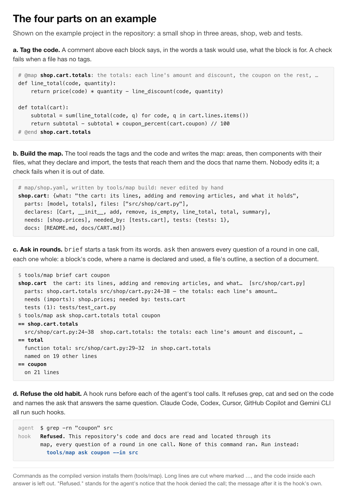
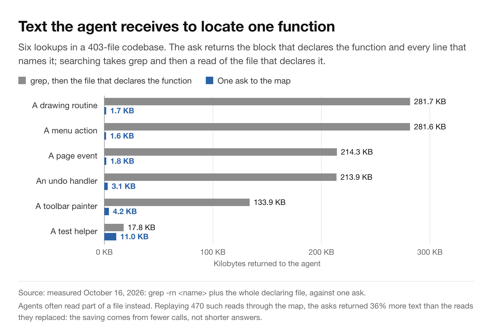
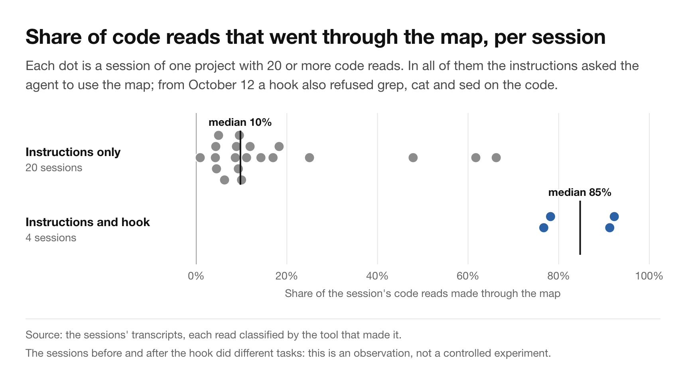

# Almost every token my coding agent used was a re-read

## I measured 113 Claude Code sessions: where the context came from, what it cost in money and seconds, and a first test of reading code through a map instead of grep.

For three weeks I kept the transcript of every session I ran with a coding agent. That came to 113 sessions in
five projects: 36 that I started, and 77 sub-agents that those sessions started to do part of the work. Between
them they made 26,007 calls to the model, which processed 10.7 billion tokens. A token is a piece of a word,
roughly three quarters of an English word; the context is everything the model receives on a call.

One number stood out before any other. **98.7% of those tokens were text the model had already been sent in an
earlier call.** The agents' own output, the code and answers they wrote, was 0.3%.

This article is about why that happens and what it costs, and about what fills the context. It also describes a
change in how the agent reads code: a map of the code, and a hook that makes the agent use it. That change moved
how my agents read; what it saves, I can so far only estimate. The data behind every figure is public, and the
measurements of tokens, cost and response time come from a script you can run on your own transcripts.

---

## Every call re-reads the conversation

A coding agent works in a loop. It sends the conversation to the model, and the model answers with a step, a tool
call: read a file, search for a name, edit a function, run the tests. The agent runs the step, appends its result
to the conversation, and sends it all again. The model keeps no memory between calls, so every call carries
everything so far: the instructions, every command and its output, every file the agent printed, every answer it
gave.

A prompt cache makes the repeated part cheaper. The provider keeps the start of the conversation it has already
seen, and reading it again costs less than reading new text. The model still reads all of it, on every call.


*Figure 1. The context sent to the model at each call of one session. What the session read is the whole area
under the curve, not its last value.*

Figure 1 is one session: a feature built in 716 calls. The first call carried 44,000 tokens, the instructions and
the task, and each call carried a little more than the one before. At 967,000 tokens, Claude Code compacted the conversation:
it summarized it to free room in the model's context window, the most text the model can take in one call. Then it grew again,
and was compacted a second time at 937,000.

The session read 380 million tokens in total, about the length of 3,200 novels (taking a novel as 90,000 words,
about 120,000 tokens). The 57% of its calls that carried 500,000 tokens or more read 77% of that.

Across all 113 sessions, the tokens split like this:

- **98.7%** were cache reads: context the model had already been sent.
- **1%** was new context, written to the cache for the calls that followed.
- **0.3%** was output: everything the model wrote.

That share is not a waste that a better habit removes. It is how agents work, and every practice later in this
article leaves it about where it is. What a practice can change is the total: how many calls a task takes, and
how much context each one carries.

Cache reads are cheap per token. On Anthropic's list prices, a cache read costs 5% of a new input token on Claude
Opus 5.5 and Claude Sonnet 5.5, writing to the cache costs 1.25 to 2 times a new input token, and output costs
five times as much as input ([pricing](https://platform.claude.com/docs/en/about-claude/pricing)). At those
prices, the calls of the 113 sessions come to about **$3,383**, split like this:

- **59.5%** for reading the context again;
- **21.6%** for writing new context to the cache: 1% of the tokens, at 1.25 to 2 times the input price;
- **18.9%** for the output.

Re-reading is the largest part of the bill, and what the model wrote is the smallest. The dollars are what these
calls cost at the API's list prices; a subscription bills differently.

## Long contexts are also slower


*Figure 2. How long the model took to reply, by the size of the context: 21,310 calls in 113 sessions.*

The model takes longer to answer as the context grows. With under 100,000 tokens of context, the median reply
took 2.7 seconds; between 700,000 and 900,000, about 8 seconds, three times as long.

Part of that is that later replies are longer: the median reply grew from 189 to about 760 tokens of output across
the range. So I looked at short replies alone, under 200 tokens. Their median still rose, from 2.25 to about
4 seconds. Even for short replies, a long context adds seconds to every call.

## What fills the context

On one day, 23 sub-agents built a feature in parallel, and between them they re-read 1.18 billion tokens. Their
transcripts allowed something like an autopsy. I traced each piece of text in their contexts back to the tool
result, the output of a step, that brought it in, and weighted it by how many later calls read it again.


*Figure 3. What filled the context while 23 sub-agents built one feature.*

Half of it was the agents finding their way around the code the usual way: the output of `grep`, `cat` and `sed`
(37%), and whole files read to find one thing in them (13%).

Picture an agent in a codebase it has never seen. It needs to know where a function is defined, so it searches the
code for the name. The search prints twenty matching lines. It opens the file that looks right, all 280 kilobytes
of it, then prints part of it again to be sure. Then it asks the next question the same way. Each printout stays in
the context, and from then on it is read again at every call.

The agent is not doing anything wrong by its own standards. It is doing what it can, without a map.

## A map of the code, read in rounds

The approach I tried has four parts.


*Figure 4. How the map works.*

1. **Tags.** A comment above each block of code says what the block is for, in the words a task would use: "the
   totals: each line's amount and discount, the coupon on the rest". Generated indexes (symbol lists, embeddings,
   language servers) say what is in the code. A tag says what the code is for, which is how a task is described.
2. **A generated map.** A small tool reads the tags and the code, and writes the map. It lists the areas of the
   codebase and what each needs from the others. For each component, it lists the files, what they declare and
   import, the tests that reach them, and the docs that name them. Nobody edits the map by hand. A check in
   continuous integration, the checks that run on every change, fails when a file has no tags or the map is out of
   date. It cannot check that a purpose is true; that rests on whoever changes the code.
3. **Two commands.** `brief` turns a task's words into the parts of the code they name, in about a hundred lines.
   `ask` answers several questions in one call, each one whole. A question can name a block, which returns its
   code. It can name a function, which returns where it is declared and every line that uses it. It can also name
   a file, for its outline, or a heading, for that section of a document.
4. **A hook.** A hook is a small program the agent runs before each tool call, and it can refuse the call. This one
   refuses `grep`, `cat` and `sed` on the code, and names the `ask` that answers the same question. Claude Code,
   Codex, Cursor, GitHub Copilot and Gemini CLI all run hooks of this kind.



*Figure 5. The four parts on the example project in the repository.*


*Figure 6. The hook at work. The agent reaches for grep, the hook refuses it and names the ask, and one call
answers with every block that mentions the coupon.*

The aim is not shorter answers but fewer calls: one call can carry a whole round of questions. Every call re-reads
the whole conversation, so the bill is roughly the number of calls times the size of the context, and those are
the two things to bring down.

## One lookup, two ways



*Figure 7. The text the agent receives to locate one function: grep plus the file that declares it, against one
ask.*

For six lookups an agent had made in a codebase of 403 files, I measured the text that enters the context two
ways. The usual way is `grep` for the name, then the whole file that declares it. The other is one `ask`. For a
drawing routine, that was 281.7 KB against 1.7 KB. For a test helper, 17.8 KB against 11.0 KB, because the helper
is short and named in many tests, and every use is part of the answer.

This comparison flatters the map, and it is worth saying how. Agents often print part of a file rather than all of
it. When I replayed the hook on five earlier sessions (more on that below), it refused 470 real reads, and the asks
it named returned 36% *more* text than those reads: 1,537 KB against 1,130 KB. An answer brings the code that
declares a name and every place that uses it, where a read brings one slice. In 49 of those cases, the longer
answer already held what the agent went on to read within its next four calls, so one call could have done the
work of two.

So any saving has to come from fewer calls, not from shorter answers, and fewer calls is what I have not yet
measured directly.

## Instructions were not enough



*Figure 8. The share of each session's code reads that went through the map, with the instructions alone and
with the hook.*

All along, the project's instructions file told the agent to use the map and not to grep. That file, `AGENTS.md` or
`CLAUDE.md`, is read by the agent at the start of every session. The agents read it, and grepped anyway. With the
instructions alone, the median session sent 10% of its code reads through the map. Sixteen of the twenty sent
between 4% and 25%, one sent 1%, and three sent between 48% and 66%. With the hook, the four sessions that
followed sent 77%, 78%, 91% and 92%.

This is not a controlled experiment, for three reasons. The sessions before and after did different tasks. Four
sessions is a small sample. And the sessions with the hook also had revised instructions and a reminder that runs
after the agent reads, both added the same day. A hook that refuses grep also raises the share by construction.
What this shows is that the habit can be changed at the level of the tool, not that agents prefer the map.

It does match a plausible mechanism. An instruction is written once, at the start of a context that keeps growing,
and competes with a habit learned from a great deal of code. A hook applies at every call.

I also replayed the hook on the 1,148 tool calls of five earlier sessions. It refused 470 of them, all shell
commands, and every ask it named ran. In 35 cases the ask found nothing, because the agent had guessed a name that
did not exist. Two shell commands that read code slipped through.

The hook takes about 23 milliseconds per call in Python, and about 3 in the Go and Rust versions. What I cannot
show yet is that sessions make fewer calls with it. The hook moved the reads to the map, and the asks that followed
carried 1.4 to 3.8 questions each, but there are not enough sessions to measure a drop in calls.

## What it could save: a replay


*Figure 9. One session replayed call by call with each practice added. Bars end at the middle of each range;
whiskers span it.*

To estimate the savings, I replayed the session of Figure 1 call by call, up to its 532nd call: 255 million tokens
by then. Replayed unchanged, it reproduces 253 million tokens and 95 minutes of model time, against 255 and 94 measured. The session
also spent 141 minutes running tools; Figure 9 shows both together as work time. Then I added each practice in
turn:

- **Test only what each change reaches, and run the whole suite once at the end.** Tokens fall 2%, and time 26%,
  because the suite no longer runs after every change.
- **Ask in rounds as well.** In all, tokens fall 33% to 43%, time 40% to 44%, and the 532 calls become 310 to 363. The two ends of
  each range assume that half, or two thirds, of the reads join a round.
- **One session per change,** each starting near 60,000 tokens instead of carrying the previous changes along.
  Tokens fall 77% to 81% in all.

Most of that last step comes from starting each change in a fresh session, which needs no map at all. The map's
part is the rounds. These are estimates from one session, and the assumptions are written down in the repository.
They are also why the instructions in my repositories now say, in this order: start with `brief`, ask in rounds,
use one session per change, check each change, and run the whole suite once.

## At the scale of a browser


*Figure 10. A projection, not a measurement: tokens and work time to write 40 million lines at the rates measured
in one project.*

Projections are easy to misread, so here is exactly what this one is.

In the 25 sessions of the project where the map was built, the agents wrote 73,211 lines, counting code, tests and
docs, rewrites included. They read 4.13 billion tokens doing it, in 37 hours of work: 17 of the model answering and
20 of tools running. That is **56 million tokens and 30 minutes of work per 1,000 lines written**.

Chromium, the open-source core of Google Chrome, is usually described as having tens of millions of lines of code.
Take 40 million as a round figure. At these rates, writing 40 million lines means reading about 2.3 trillion
tokens, and about 28 months of one agent working without pause. Testing only what each change reaches barely
moves the tokens. Asking in rounds brings them to 1.3 to 1.5 trillion, and one session per change to 0.4 to 0.5
trillion: in this projection, about 1.8 trillion fewer tokens.

This is an extrapolation from one project's rates, with the replay's reductions applied. Writing 40 million lines
is not building a browser, and lines written include rewrites, so the real figure would be higher. Agents in
parallel divide the time, not the tokens. The point is the shape: the cost of reading code the expensive way grows
with everything else.

## Related tools


*Figure 11. How related tools give a coding agent a view of the code, as each tool's own pages describe it.*

Many tools give an agent a view of a repository. Aider sends a ranked list of symbols with every request. Repomix
packs the repository into one file. Serena exposes a language server's symbols through MCP, a standard way to give
agents tools. Cursor and Copilot index the code for search, and instruction files such as `CLAUDE.md` and
`AGENTS.md` carry what people write. Among newer projects, codemap builds a dependency graph, and agentmap by
raymondchins an import graph, with a hook that refuses some searches in Cursor and Codex. The closest to this map
is agentmap by remorses, which builds an inventory of the codebase from the header comments people write.

What the map adds is a combination:

- a purpose for every block rather than every file, written by people or agents and kept present by CI;
- answers on demand, a round of questions per call, instead of a fixed map in every request;
- a hook that refuses the old way of reading, in five agent tools;
- a way to measure its effect from the agent's own transcripts: the reads are measured, the tokens so far only
  estimated by replay.

What it lacks is as clear. It sees imports, not calls or types, and someone has to write the tags. Several of these
tools can be combined: a language-server tool such as Serena sees calls and references that tags do not.

A related study: a paper at ISSTA 2026 ([arXiv 2606.26979](https://arxiv.org/abs/2606.26979)) adds structural
facts to code as plain comments before an agent reads it, and reports that this roughly halves the run-to-run
variance of the agent, at about 10% more input tokens. It measured consistency, not cost. Tags are comments of a
similar kind, written for purpose rather than structure.

## What this does not show

- **One developer, one agent product, mostly one model.** These are Claude Code sessions, 86% of the calls to
  Claude Opus 5.5, in five projects over three weeks. Agents built on other models also process their whole
  context on every call, but I have not measured them.
- **The hook's effect rests on four sessions**, against twenty before it, on different tasks, with other changes
  made the same day.
- **The savings are estimates.** They come from replaying one session, and the projection extrapolates one
  project's rates.
- **The lookups compare one habit, grep and then the whole file, with one ask.** On the reads agents actually
  made, the asks returned more text, not less.
- **Tags can go stale.** CI checks that every block has one and that the map is current, not that each purpose is
  still true.
- **Response time includes writing the reply.** That is why short replies are shown on their own.
- **Nothing here measures the quality of the work,** only what it cost to do.

## Code and data

The tool, the hook and the measurements are open source as **grepless**:
[github.com/mars1571/grepless](https://github.com/mars1571/grepless). The tool exists in Python, Node, Go and
Rust; all four write the same map, byte for byte, and give the same answers in a 46-case conformance suite.
The hook runs before every tool call, so its own cost matters (Figure 12).


*Figure 12. Run time of the four implementations, on one scale.*

Claude Code keeps every session's transcript on disk under `~/.claude/projects/`, for 30 days by default
([docs](https://code.claude.com/docs/en/data-usage)). From a clone of the repository, this script reads those
transcripts and prints, for your machine, the token split, the cost shares and the response times of Figure 2:

```
python3 article/analysis/transcripts.py
```

The measurements that depend on the project where the map was built (Figures 1, 3 and 7 to 10) cannot be rerun
without its code and transcripts, which are private; their data is in the repository.

## Method notes

- **Calls and context.** A call is one message from the model in a Claude Code transcript. Its context is the sum
  of its input, cache-read and cache-write tokens, as the transcript records them.
- **Sessions.** Every transcript on my machine with 20 or more calls, from September 21 to October 12, 2026,
  including sub-agents. The session that wrote this article is left out.
- **Response time.** The seconds from the transcript line before a call (usually a tool's result) to the call's
  last line. Calls under 0.3 seconds or over 300 seconds are left out.
- **Cost.** Each call is priced at its own model's list price, read on October 17, 2026. That covers 97% of the
  calls; the rest are priced as Claude Opus 5.5.
- **Composition (Figure 3).** The growth of each agent's context is attributed to the tool result that caused it,
  weighted by the number of later calls that re-read it.
- **Replay (Figure 9).** Each call's context is recomputed with the practice applied, and its time is scaled by the
  new context. Starting the extra sessions is not counted, about 1% of the tokens.
- **Projection (Figure 10).** Lines written count every line the agent wrote to any file, whole, as a replacement
  or from a script, so rewrites count again. Work time is the model answering plus the tools running; waits for
  the person are left out.

The data behind every figure, the scripts that draw them, and the two scripts that measure transcripts are in the
repository, under [article/](https://github.com/mars1571/grepless/tree/main/article).
